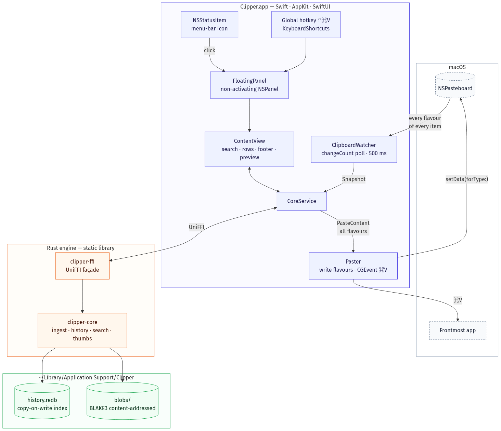

<h1 align="center">
  <br>
  Clipper
</h1>

<p align="center">
  A native macOS clipboard manager that pastes <em>exactly</em> what you copied.<br>
  AppKit/SwiftUI shell · Rust storage engine · lives in the menu bar · opens with ⇧⌘V
</p>

<p align="center">
  <a href="https://github.com/kkrishnan90/Clipper4Mac/actions/workflows/ci.yml"></a>
  <a href="https://github.com/kkrishnan90/Clipper4Mac/releases/latest"></a>
  
  
  <a href="LICENSE"></a>
</p>

---

## Install

**Homebrew** (recommended):

```sh
brew tap kkrishnan90/clipper4mac
brew install --cask clipper4mac
```

Later: `brew upgrade --cask clipper4mac` to update, `brew uninstall --zap --cask clipper4mac` to remove the app and its history.
(One-liner without tapping first: `brew install --cask kkrishnan90/clipper4mac/clipper4mac`.)

**Direct download:** grab `Clipper-<version>.dmg` from the [latest release](https://github.com/kkrishnan90/Clipper4Mac/releases/latest),
drag Clipper to Applications, and open it. Requires **macOS 14 Sonoma** or newer; runs natively on Apple Silicon and Intel.

> **Unsigned builds.** Until the app ships with a Developer ID, macOS may say it "cannot be opened".
> Run `xattr -cr /Applications/Clipper.app` once (the cask does this for you).

On first paste Clipper asks for **Accessibility** access (System Settings → Privacy & Security → Accessibility).
That permission is what lets it press ⌘V in the app you came from; without it, items are still put on the clipboard and you paste manually.

## Why another clipboard manager?

| Problem with most OSS clipboard managers | What Clipper does |
| --- | --- |
| Rich text comes back mangled, Markdown loses its formatting, tables become plain text | Stores **every pasteboard flavour** (`public.utf8-plain-text`, `public.html`, `public.rtf`, `com.apple.iWork.*`, …) byte-for-byte and writes them all back. What you paste is what you copied. |
| SQLite history that eventually corrupts, or memory that grows until the app is restarted | A Rust engine on **redb** (copy-on-write, atomic commits, no WAL) with payloads as immutable **content-addressed files**. Bad rows are dropped, never fatal. Only summaries and small thumbnails stay in memory. |
| Web-view UIs that don't feel like macOS | A real `NSPanel` with vibrancy, stock SwiftUI controls, the system shortcut recorder and About panel. The same construction as Maccy. |

## Why Clipper, if Maccy exists?

[Maccy](https://github.com/p0deje/Maccy) set the standard for what a macOS clipboard manager should feel like, and Clipper keeps that feel: the same kind of non-activating panel, the same keyboard model, every pasteboard flavour preserved. Where Clipper goes further is underneath — the part you notice only when it fails.

| | Maccy | Clipper |
| --- | --- | --- |
| Native panel UI, keyboard-first | ✓ | ✓ |
| Pastes every pasteboard flavour back exactly | ✓ | ✓ |
| History database | SwiftData on SQLite; text and image payloads stored as blobs inside the database file | **redb** — copy-on-write B-tree, every commit atomic, no write-ahead log to lose or replay |
| Payload storage | Inside the SQLite file | **Immutable content-addressed files** (BLAKE3), written `tmp → fsync → rename`, so a payload can never be half-written |
| Database won't open at launch | App stops with a fatal error | **Self-heals**: the file is quarantined aside, a fresh store opens, and the app starts |
| Corrupt record | — | **Isolated**: every row is decoded independently; a bad one is dropped and logged, the rest load |
| Engine | Swift, in-process | **Rust** (`clipper-core`), memory-safe, no garbage collector, called from Swift through UniFFI |
| Engine test-suite | Swift unit + UI tests | 41 Rust unit tests covering ingest, dedup, caps, recovery, search and FFI round-trips — runnable on any OS, in CI on every push |
| Memory footprint by design | Managed by SwiftData | Only row summaries and ≤ 320 px thumbnails stay resident; payloads are read on demand and history is capped by `maxItems` |
| Index size | Grows with payloads | Stays small — the index holds metadata only, so scans, backups and recovery stay fast |
| License | MIT | MIT |

In one sentence: Clipper is a Maccy-style front end on a storage engine designed so that history cannot corrupt, cannot tear, and cannot crash the app — and that design is unit-tested in isolation from macOS.

## Features

- **Menu bar item** – template icon (follows light/dark), left-click opens history, right-click gives Open · Pause Recording · Preferences… · About · Quit.
- **History popup** – search field, one row per item with ⌘1–⌘9 for the first nine, thumbnails for images, swatches for colours, optional source-app icons.
- **Hover preview** – full content plus *Application · First copy · Last copy · Number of copies · Size · Formats*.
- **Everything copyable** – text, links, colours, images, files and folders (including videos and any other file type, by path), and app-private formats.
- **Exact paste** by default; ⌥⏎ pastes plain text when you want to strip formatting; ⇧⏎ copies without pasting.
- **Pin** items so they survive Clear and never age out.
- **Configurable shortcuts** – open (default ⇧⌘V), pin (⌥P), delete (⌥⌫) via the standard macOS recorder.
- **Preferences** – popup position (cursor / status item / active window / centre / last position), menu bar icon, launch at login, paste-vs-copy, history size, what to store, ignored apps, clear on quit.
- **Privacy** – copies flagged concealed or transient by password managers (`org.nspasteboard.*`) are never recorded; add any app to the ignore list; nothing ever leaves your Mac.

## Keyboard reference (popup open)

| Keys | Action |
| --- | --- |
| ↑ ↓ · ⌘J ⌘K · PgUp PgDn · Home End | Move selection |
| ⏎ | Paste (or copy only, if "Paste automatically" is off) |
| ⇧⏎ | Copy only (inverts the above) |
| ⌥⏎ | Paste without formatting |
| ⌘1 … ⌘9 | Paste the n-th item |
| ⌥P | Pin / unpin |
| ⌥⌫ | Delete |
| ⌥⌘⌫ · ⇧⌥⌘⌫ | Clear · Clear all (including pinned) |
| ⌘, | Preferences |
| esc | Clear search, then close |

## Building from source

Requirements: macOS 14+, **Xcode 16 or newer** (the full app, not just the Command Line Tools), [Rust](https://rustup.rs).

```sh
git clone https://github.com/kkrishnan90/Clipper4Mac && cd Clipper4Mac
scripts/build-macos.sh --install      # build → /Applications/Clipper.app → launch
```

`build-macos.sh` compiles the Rust engine as a static library, generates the Swift bindings with [UniFFI](https://mozilla.github.io/uniffi-rs/),
runs `swift build`, assembles and signs the bundle. Useful flags: `--debug` (fast iteration), `--universal --dmg` (what the release
workflow ships), or `scripts/brew-local.sh` to install your local build through Homebrew via a local tap.

> **Tip for developers.** macOS ties the Accessibility grant to the code signature, and ad-hoc signatures change every build.
> Create a self-signed *Code Signing* certificate in Keychain Access (e.g. `Clipper Dev`) and `export CODESIGN_IDENTITY="Clipper Dev"` so the grant survives rebuilds.

```sh
cargo test --workspace          # engine + FFI tests (run anywhere, including Linux)
scripts/check-macos-on-linux.sh # cross-check the darwin target from a Linux box
```

## How it works

<p align="center">
  
</p>

Details, including the reliability design and threading model, are in [docs/ARCHITECTURE.md](docs/ARCHITECTURE.md).
Release mechanics are in [docs/RELEASING.md](docs/RELEASING.md).

## Project layout

```
crates/clipper-core     engine: ingest, history, redb store, blob store, search, thumbnails (unit-tested)
crates/clipper-ffi      UniFFI façade exported to Swift (static library)
crates/uniffi-bindgen   the bindings generator binary
macos/                  SwiftPM package: the app (AppKit + SwiftUI)
packaging/homebrew      the cask (mirrored to kkrishnan90/homebrew-clipper4mac on release)
scripts/                build-macos.sh · brew-local.sh · gen-icons.sh · check-macos-on-linux.sh
```

## Status

`0.2.x` — the first native builds. The engine has a full test suite; the app is young and has had limited real-world use.
Please [open an issue](https://github.com/kkrishnan90/Clipper4Mac/issues) with the app you were copying from and the *Formats* line from the preview when something pastes wrong.

## Acknowledgements

The panel behaviour, keyboard model and overall layout follow [Maccy](https://github.com/p0deje/Maccy) (MIT), the reference for what a macOS clipboard manager should feel like.
Global shortcuts use [KeyboardShortcuts](https://github.com/sindresorhus/KeyboardShortcuts) by Sindre Sorhus.

## License

Copyright © 2026 kkrishnan90. Released under the [MIT License](LICENSE) — free for personal and commercial use, modification and redistribution.
